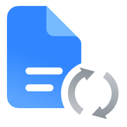

<div align="center">
  <h1>google-docs-sync</h1>
  <br/>
  <p>
    
  </p>
  <br/>

[![Build Status][badge-build]][actions]
[![MIT license][badge-licence]](./LICENCE.md)
[![PRs welcome][badge-prs]](#contributing)
[![Paypal][badge-paypal]](https://paypal.me/cedricdelpoux)

</div>

---

Use Google Docs as a content source. This monorepo holds the packages that read a Google Doc, convert it to Markdown or MDX, and handle the Google authentication they need.

| Package                                                             | Version                      | Description                                                              |
| ------------------------------------------------------------------- | ---------------------------- | ------------------------------------------------------------------------ |
| [`gatsby-source-google-docs`](./packages/gatsby-source-google-docs) | [![npm][v-gatsby]][n-gatsby] | Gatsby plugin that uses Google Docs as a data source                     |
| [`google-docs-sync`](./packages/google-docs-sync)                   | [![npm][v-sync]][n-sync]     | Sync a Google Drive folder of Google Docs to local Markdown or MDX files |
| [`google-docs-to-markdown`](./packages/google-docs-to-markdown)     | [![npm][v-md]][n-md]         | Convert a Google Docs API document to Markdown or MDX                    |
| [`google-oauth2-env-vars`](./packages/google-oauth2-env-vars)       | [![npm][v-oauth]][n-oauth]   | Generate and cache Google OAuth 2.0 tokens in `.env` files               |

## Which package do I need?

- **A Gatsby site**: [`gatsby-source-google-docs`](./packages/gatsby-source-google-docs).
- **Another framework, a build script or the command line**: [`google-docs-sync`](./packages/google-docs-sync).

  ```shell
  npx google-docs-sync --folder <id>
  ```

  ```js
  import {syncGoogleDocs} from "google-docs-sync"

  const {documents} = await syncGoogleDocs({
    folder: "FOLDER_ID",
    outputDir: "src/content/docs",
  })
  ```

- **Only the conversion of a Google Docs API document**: [`google-docs-to-markdown`](./packages/google-docs-to-markdown).
- **Only Google OAuth tokens in `.env` files**: [`google-oauth2-env-vars`](./packages/google-oauth2-env-vars).

## How it works

`gatsby-source-google-docs` is a thin adapter over `google-docs-sync`, which owns the Google APIs and the filesystem. Each package has its own README and CHANGELOG.

```text
gatsby-source-google-docs
  └─ google-docs-sync
       ├─ google-docs-to-markdown
       └─ google-oauth2-env-vars
```

## Development

The repository uses [npm workspaces](https://docs.npmjs.com/cli/using-npm/workspaces) and requires Node.js 22.12 or later.

```shell
npm install
npm run lint   # build, then eslint and tsc in each package, then prettier
npm test       # run the tests of each package
npm run build  # generate the type declarations of each package
npm run format # format the repository with prettier
```

Use `-w <package>` to run a script in one package, for example `npm test -w google-docs-to-markdown`.

## Contributing

- Pull requests and stars are always welcome.
- For bugs and feature requests, please [create an issue][github-issue].
- A change to a package comes with a changeset: run `npm run changeset` (see [Releases](#releases)).
- Run the tests of one package with `npm test -w <package>`, for example `npm test -w google-docs-sync`.

## Releases

The packages are versioned independently with [changesets](https://github.com/changesets/changesets).

1. Run `npm run changeset` to choose the packages and the bump (patch, minor or major) and to describe the change. Commit the generated file with your pull request.
2. When the pull request is merged into `master`, the `Release` workflow opens a "Version packages" pull request. It bumps the versions, updates the changelogs and the dependency ranges between the packages.
3. Merging the "Version packages" pull request publishes the new versions to npm with their provenance and creates the git tags.

## Support

If this project is useful to you, you can give it a star, or [sponsor it with PayPal](https://paypal.me/cedricdelpoux). You can also visit [cedricdelpoux.fr](https://cedricdelpoux.fr/en).

## License

[MIT](./LICENCE.md)

[badge-build]: https://img.shields.io/github/actions/workflow/status/cedricdelpoux/google-docs-sync/ci.yml?branch=master&style=flat-square
[badge-licence]: https://img.shields.io/badge/license-MIT-blue.svg?style=flat-square
[badge-prs]: https://img.shields.io/badge/PRs-welcome-brightgreen.svg?style=flat-square
[badge-paypal]: https://img.shields.io/badge/sponsor-PayPal-3b7bbf.svg?style=flat-square
[actions]: https://github.com/cedricdelpoux/google-docs-sync/actions/workflows/ci.yml
[github-issue]: https://github.com/cedricdelpoux/google-docs-sync/issues/new
[v-gatsby]: https://img.shields.io/npm/v/gatsby-source-google-docs.svg?style=flat-square
[n-gatsby]: https://www.npmjs.com/package/gatsby-source-google-docs
[v-sync]: https://img.shields.io/npm/v/google-docs-sync.svg?style=flat-square
[n-sync]: https://www.npmjs.com/package/google-docs-sync
[v-md]: https://img.shields.io/npm/v/google-docs-to-markdown.svg?style=flat-square
[n-md]: https://www.npmjs.com/package/google-docs-to-markdown
[v-oauth]: https://img.shields.io/npm/v/google-oauth2-env-vars.svg?style=flat-square
[n-oauth]: https://www.npmjs.com/package/google-oauth2-env-vars
